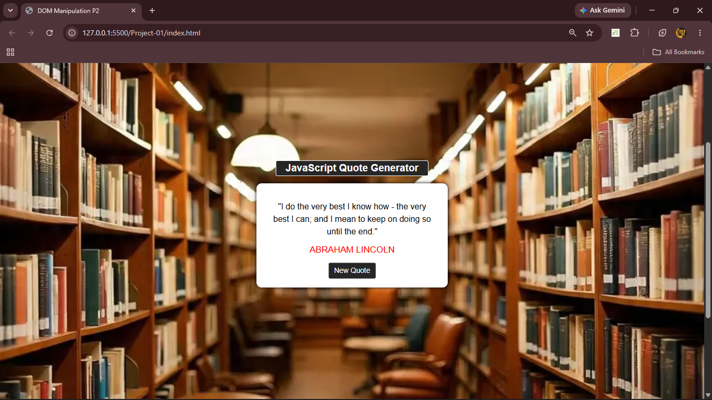

# Project 01 — JavaScript Quote Generator

A simple and interactive **JavaScript Quote Generator** built using HTML, CSS, and JavaScript. The application displays inspirational quotes along with their authors and allows users to generate a new random quote with a single click.

## 📸 Screenshot



## ✨ Features

- Displays an inspirational quote and its author.
- Generates a random quote when the **New Quote** button is clicked.
- Includes a collection of quotes from different personalities and writers.
- Uses JavaScript DOM manipulation to update the quote and author dynamically.
- Provides a simple, clean interface with custom CSS styling.

## 🛠️ Technologies Used

- **HTML5** — Structures the webpage and its content.
- **CSS3** — Styles the quote container, text, background, and button.
- **JavaScript** — Selects random quotes and updates webpage content using DOM manipulation.
- **Google Fonts** — Loads custom typography.
- **Font Awesome** — Includes the Font Awesome stylesheet.

## 📁 Project Structure

```text
Project-01/
├── index.html
├── style.css
├── project-01.js
├── project-1.jpg
├── Quote-Generator.png
└── README.md
```

## 🚀 How to Run

1. Clone or download this repository.
2. Open the `Project-01` folder.
3. Open `index.html` in your web browser.
4. Click **New Quote** to display a randomly selected quote.

You can also open the project in Visual Studio Code and run it using the Live Server extension.

## 🧠 What I Learned

- Selecting HTML elements using JavaScript DOM methods.
- Handling button click events with `addEventListener()`.
- Using arrays and objects to store quotes and author names.
- Generating random array indexes with `Math.random()` and `Math.floor()`.
- Updating webpage content dynamically with `innerText`.
- Separating HTML, CSS, and JavaScript into individual files.

## 🔮 Future Improvements

- Add more inspirational quotes.
- Prevent the same quote from appearing consecutively.
- Add a copy-quote button.
- Make the layout responsive across different screen sizes.
- Add an option to share quotes on social media.

## 👨‍💻 Author

**Madan S K**

---

*Project created for learning and practicing JavaScript fundamentals and DOM manipulation.*