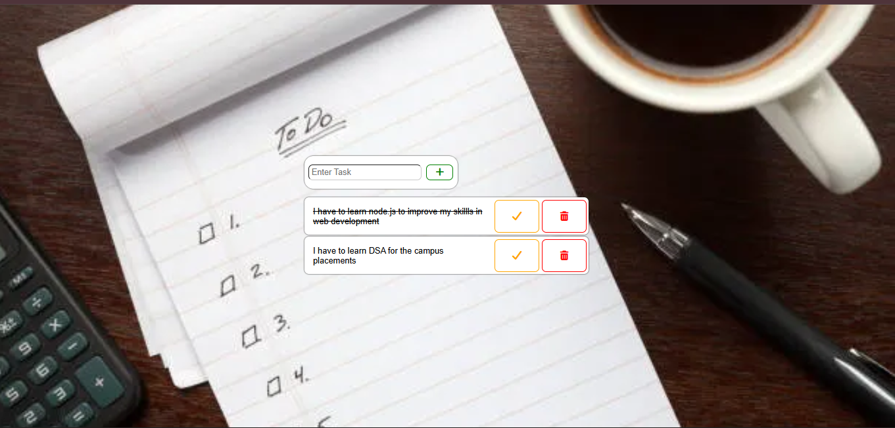

# To-Do List Web Application

A simple and interactive To-Do List web application built using HTML, CSS, and JavaScript. It features a background image, a task input field, and interactive buttons for managing tasks.

## Screenshot



## Features

- **Add Tasks:** Enter a task and add it to the list.
- **Complete Tasks:** Mark tasks as completed using the check button.
- **Delete Tasks:** Remove tasks using the delete button.
- **Dynamic Updates:** Add and manage tasks using JavaScript DOM manipulation.
- **Background Image:** Uses a background image styled with CSS.
- **Icon Buttons:** Uses Font Awesome icons for task actions.

## Technologies Used

- HTML5
- CSS3
- JavaScript
- Font Awesome
- Google Fonts

## Project Structure

```text
Project-05/
├── index.html
├── style.css
├── project-05.js
├── project-5.jpg
├── todo-list-screenshot.png
└── README.md
```

## How to Run

1. Clone the repository:

   ```bash
   git clone https://github.com/MadanSiddarth/Web-Development-Projects.git
   ```

2. Open the `Project-05` folder.
3. Open `index.html` in your browser, or use the Live Server extension in Visual Studio Code.
4. Enter a task and click the plus button to add it.
5. Use the check button to mark a task as completed.
6. Use the delete button to remove a task.

**Note:** An internet connection is required to load Google Fonts and Font Awesome.

## Future Improvements

- Save tasks using Local Storage.
- Edit existing tasks.
- Add deadlines and priority levels.
- Filter completed and pending tasks.

## Author

Madan S K